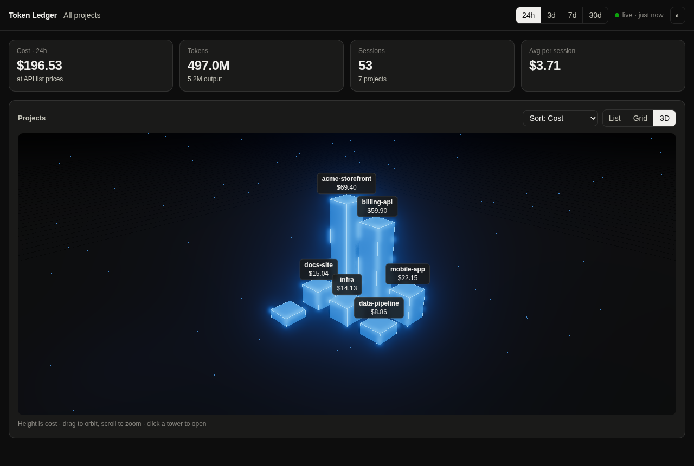
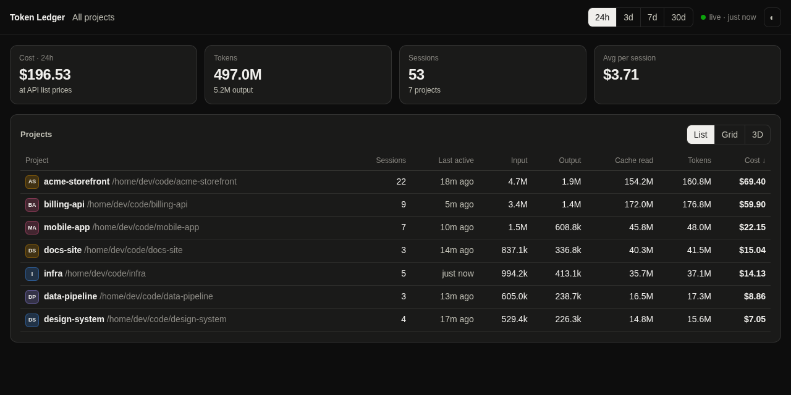
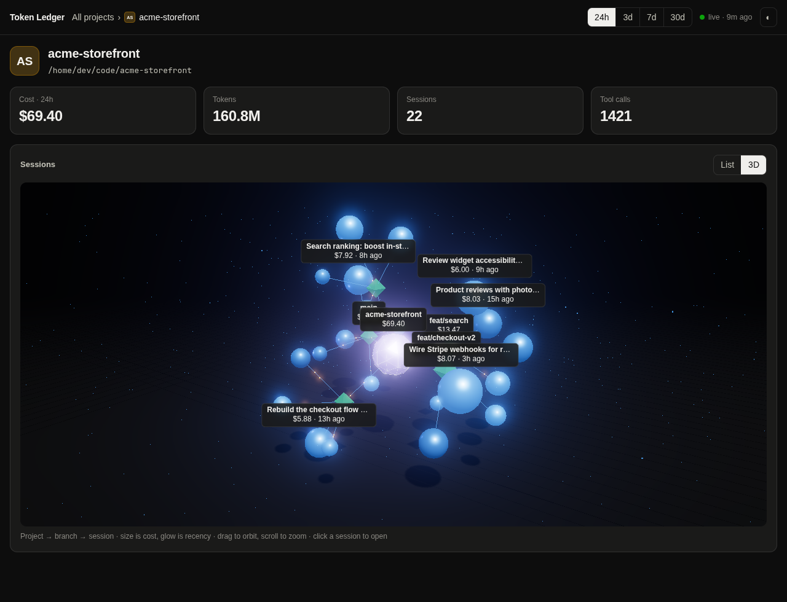
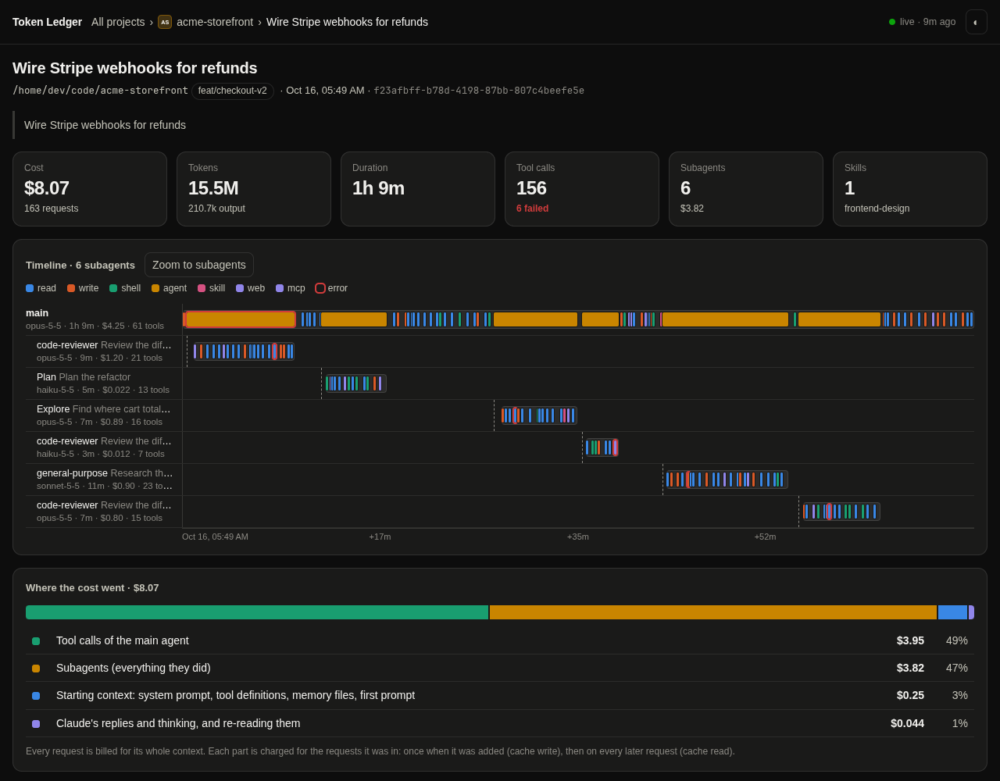

# token-ledger

**See what your Claude Code work costs**: tokens and dollars per project, per session, per subagent and per tool call. It reads the transcripts Claude Code already keeps in `~/.claude/projects`, and nothing leaves your machine.



It comes in two parts:

- **`/tokens`**: a pane inside Claude Code, docked beside the transcript in fullscreen. It shows your projects, their sessions and one session in detail, and refreshes after every turn.
- **`/tokens web`**: a local dashboard at http://127.0.0.1:4610 that refreshes after every tool call, the moment a transcript changes.

Both cover the last 24 hours, 3 days, 7 days or 30 days.

## What it shows

### Projects

Projects are grouped by git repository: every worktree of a repo counts toward that repo, even after the worktree is deleted. A folder outside git is its own project. Each project shows its own icon when it has one.

You can view them as a sortable **list**, as a **grid** of cards, or in **3D** as a skyline (pictured above). In the skyline, each tower is a project and its height is the cost. Drag to orbit, scroll to zoom and click a tower to open the project.



### Sessions

A project's sessions are listed with their title, branch, worktree, model, tool calls, tokens and cost.

The **3D** view draws them as a graph: the project in the middle, the git branches around it and each session as a sphere. A sphere's size is its cost, and recent sessions glow brighter. Click a sphere to open that session.



### One session

- **Timeline**: one row for the main agent and one per subagent, so subagents running in parallel show up side by side. Each tool call is a mark coloured by its kind, and failed calls are outlined in red. Idle stretches collapse, and you can zoom to the subagents.
- **Where the cost went**:
  - tool calls
  - subagents
  - the starting context (system prompt, tool definitions, memory files)
  - your messages and injected context
  - Claude's replies and thinking

  The parts add up to the session total.
- **Cost by tool**, and every tool call with its own cost, searchable and sortable.
- **Models** per agent, skills used, and tokens by type.



The screenshots show made-up demo projects.

## Install

At the prompt of a Claude Code session:

```
/plugin install token-ledger --marketplace Maduki-tech/token-ledger
```

Answer `y` to add the marketplace, then pick a scope. From a shell:

```
claude plugin install token-ledger --marketplace Maduki-tech/token-ledger
```

In the desktop app, where `/plugin` does not run: click **+** next to the prompt box, then **Plugins**, **Add marketplace** with `Maduki-tech/token-ledger`, then **Add plugin**.

It needs only `python3` (standard library). `/tokens web` opens your browser with `xdg-open` on Linux and `open` on macOS. The 3D views need WebGL; without it, use the list.

## Usage

| Command | What it does |
| --- | --- |
| `/tokens` | Opens the pane. Keys: `1`–`4` pick the time window, `b` goes back, `r` refreshes. |
| `/tokens web` | Starts the local server and opens the dashboard. Running it again replaces a server that is already running, so you always get the current version. |

## How cost is worked out

Prices are Anthropic's API list prices, kept in `PRICES` in `scripts/usage.py`. On a subscription, this is what the same work would cost through the API.

The API bills per request, not per tool call. Each request pays output for what it writes and input for its whole context. The ledger charges every piece of that context (a tool result, your message, the system prompt) for the requests it was part of: at the cache-write rate when it was added, and at the cache-read rate on every later request. Those estimates are scaled per request to what the request really cost, so every dollar lands somewhere. When one reply makes several tool calls, its output is split evenly between them.

## Privacy

- The ledger only reads `~/.claude/projects`. It writes one small cache of which folder belongs to which git repo, in `~/.cache/token-ledger`.
- The dashboard server listens on 127.0.0.1 only, and it loads nothing from the internet.

## Developing

Clone it anywhere and point Claude Code at the folder:

```
claude --plugin-dir /path/to/token-ledger
```

or add the path to `env.CLAUDE_CODE_PLUGIN_DIRS` in `~/.claude/settings.json` so every session loads it. Edits reload the mod when the turn ends.

```
python3 scripts/usage.py selftest   # the cost attribution and grouping
claude plugin test .                 # the pane and /tokens web
claude plugin validate .
```

| Path | Role |
| --- | --- |
| `hooks/register.tsx` | the pane and the `/tokens` command |
| `scripts/usage.py` | reads the transcripts and works out the costs |
| `scripts/server.py` | the local web server, bound to 127.0.0.1 only |
| `web/src` | the dashboard: Svelte, Tailwind, and three.js for the 3D views |
| `web/dist` | the built dashboard, committed so users need no Node |
| `docs/` | the README screenshots |

After changing anything in `web/src`, rebuild and commit `web/dist` with it:

```
cd web && npm install && npm run build
npm run dev   # hot reload on http://localhost:5173, with the API from a running server.py
```

## License

MIT
